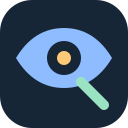
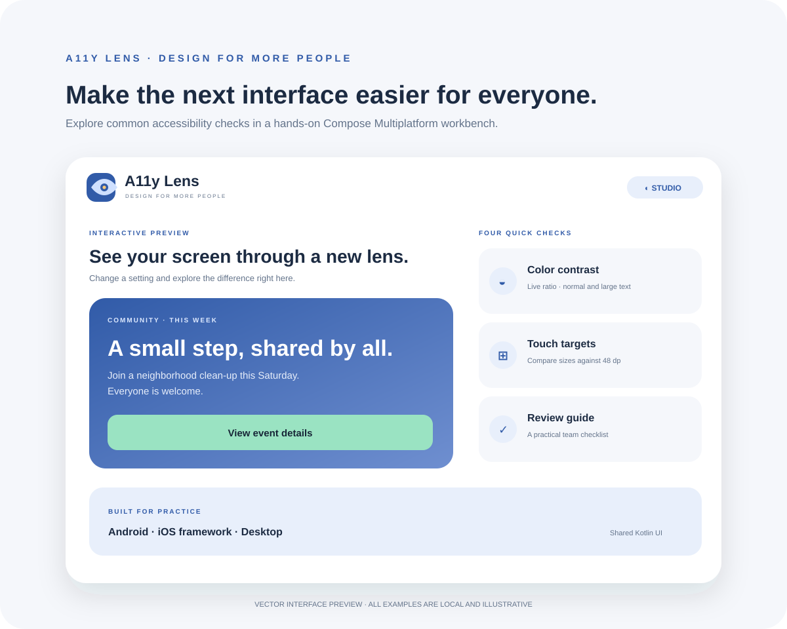

<div align="center">
  
  <h1>A11y Lens KMP</h1>
  <p><strong>Design for more people.</strong><br/>A small, practical accessibility workbench built with Kotlin Multiplatform and shared Compose UI.</p>
  <p>
    
    
    
  </p>
</div>



> This is a vector interface preview, not a device screenshot. All examples use local sample content.

## Why this project

Accessibility checks are easiest to discuss when a team can see and change the interface. A11y Lens is a hands-on demo for reviewing a few common design concerns and learning what to check next. It is intentionally not an automated scanner or a compliance claim.

## What’s inside

- **Interactive preview:** change the sample screen with larger text and high-contrast settings.
- **Contrast checker:** calculate the WCAG contrast ratio for three sample foreground/background pairs and compare the common AA thresholds for normal and large text.
- **Touch target inspector:** tap target samples at different dp sizes and see whether they meet the 48 dp recommendation used in this demo.
- **Review guide:** use a tappable checklist for keyboard access, screen-reader reading order, text scaling, contrast, and touch feedback.
- **Three palettes:** Studio, Sprout, and Night.
- **Shared Compose UI:** Android app, iOS framework, and desktop entry point use the same common screen code.

## Project layout

- `:androidApp` — Android entry point, app label, and launcher mark.
- `:shared` — common Compose UI, contrast math, iOS framework, and desktop app.

## Build

Use JDK 17. The Gradle wrapper pins Gradle 8.12.1.

```sh
./gradlew :androidApp:assembleDebug
./gradlew :shared:run
./gradlew :shared:linkDebugFrameworkIosSimulatorArm64
```

The iOS framework is configured for device and simulator architectures. An iOS host app can consume the generated `A11yLensShared` framework.

## Limitations

This is a learning and design-review aid. It does not inspect another app, test a device’s accessibility services, or certify conformance. The contrast values are computed from the sample colors; a complete review also needs real content, platform behavior, and feedback from people with disabilities.

## References

- [WCAG 2.2: Contrast (Minimum)](https://www.w3.org/WAI/WCAG22/Understanding/contrast-minimum.html)
- [Android accessibility principles](https://developer.android.com/guide/topics/ui/accessibility)
